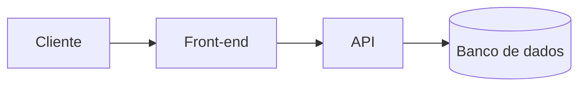

<!-- markdownlint-disable MD033 MD041 -->
<!--
╔══════════════════════════════════════════════════════════════╗
║  TEMPLATE BASE DE README.md — como usar                      ║
╠══════════════════════════════════════════════════════════════╣
║  1. Copie este arquivo para a raiz do projeto.               ║
║  2. Substitua tudo que estiver entre [colchetes].            ║
║  3. Cada seção tem um nível:                                 ║
║       🟢 BASE          → todo projeto precisa                ║
║       🟡 INTERMEDIÁRIO → projetos com mais de 1 módulo/dev   ║
║       🔴 AVANÇADO      → sistemas, APIs, infraestrutura      ║
║  4. Apague as seções que não se aplicam e REMOVA todos os    ║
║     comentários HTML antes de publicar.                      ║
╚══════════════════════════════════════════════════════════════╝
-->

<!-- 🟢 BASE — Cabeçalho -->
<div align="center">

# Spotify

**[Uma frase curta que explica o que o projeto faz e para quem.]**

<!-- 🟡 INTERMEDIÁRIO — Badges (apague as que não usar) -->


<!-- Exemplos extras: build/CI, cobertura de testes, versão do Node/Python -->

[Demo](https://[link-da-demo]) · [Documentação](./docs) · [Reportar bug](../../issues) · [Sugerir melhoria](../../issues)

</div>

---

<!-- 🟡 INTERMEDIÁRIO — Sumário (útil quando o README passa de ~150 linhas) -->
## 📑 Sumário

- [Sobre](#-sobre)
- [Funcionalidades](#-funcionalidades)
- [Tecnologias](#-tecnologias)
- [Começando](#-começando)
- [Uso](#-uso)
- [Estrutura do projeto](#-estrutura-do-projeto)
- [Configuração](#configuração)
- [Testes](#-testes)
- [Deploy](#-deploy)
- [Arquitetura](#-arquitetura)
- [Roadmap](#-roadmap)
- [Contribuindo](#-contribuindo)
- [Licença](#-licença)
- [Autor](#-autor)

---

<!-- 🟢 BASE — Sobre -->
## 📖 Sobre

[Explique em 2 a 4 parágrafos:]

- **O problema:** [que dor ou necessidade o projeto resolve]
- **A solução:** [como o projeto resolve]
- **Para quem:** [público-alvo ou contexto de uso]

<!-- 🟡 INTERMEDIÁRIO — Preview visual (prints, GIF ou vídeo curto) -->
<!--
<p align="center">
  
</p>
-->

---

<!-- 🟢 BASE — Funcionalidades -->
## ✨ Funcionalidades

- [x] [Funcionalidade já implementada]
- [x] [Funcionalidade já implementada]
- [ ] [Funcionalidade planejada]

---

<!-- 🟢 BASE — Tecnologias -->
## 🛠 Tecnologias

| Camada          | Tecnologia                 |
| --------------- | -------------------------- |
| Front-end       | [HTML, CSS, JavaScript...] |
| Back-end        | [Node, PHP, Python...]     |
| Banco de dados  | [MySQL, PostgreSQL...]     |
| Infraestrutura  | [Docker, Nginx, Linux...]  |
| Ferramentas     | [Git, VS Code, Figma...]   |

<!-- Em projetos simples, uma lista basta:
- HTML5
- CSS3
- JavaScript
-->

---

<!-- 🟢 BASE — Começando -->
## 🚀 Começando

### Pré-requisitos

- [Ferramenta] `>= [versão]`
- [Ferramenta] `>= [versão]`

### Instalação

```bash
# 1. Clone o repositório
git clone https://github.com/[usuario]/[repositorio].git

# 2. Acesse a pasta do projeto
cd [repositorio]

# 3. Instale as dependências
[comando de instalação, ex.: npm install]
```

### Executando

```bash
# Ambiente de desenvolvimento
[comando, ex.: npm run dev]
```

> 💡 **Projeto estático (HTML/CSS puro)?** Basta abrir o `index.html` no navegador
> ou usar uma extensão como o *Live Server*. Nesse caso, apague a seção de instalação.

---

<!-- 🟢 BASE — Uso -->
## 💻 Uso

[Mostre o caminho mais comum de uso, com exemplos práticos.]

```bash
[exemplo de comando, chamada de API ou trecho de código]
```

---

<!-- 🟡 INTERMEDIÁRIO — Estrutura do projeto -->
## 📂 Estrutura do projeto

```text
[repositorio]/
├── src/            # Código-fonte principal
│   ├── components/ # [descrição]
│   └── ...
├── docs/           # Documentação adicional e imagens
├── tests/          # Testes automatizados
├── .env.example    # Modelo de variáveis de ambiente
├── LICENSE
└── README.md
```

---

<!-- 🟡 INTERMEDIÁRIO — Configuração -->
## ⚙️ Configuração

Copie o arquivo de exemplo e ajuste os valores:

```bash
cp .env.example .env
```

| Variável        | Descrição                      | Obrigatória | Exemplo                 |
| --------------- | ------------------------------ | :---------: | ----------------------- |
| `[VARIAVEL_1]`  | [o que ela controla]           |     Sim     | `[valor]`               |
| `[VARIAVEL_2]`  | [o que ela controla]           |     Não     | `[valor]`               |

> ⚠️ **Nunca** faça commit do arquivo `.env`. Ele deve estar no `.gitignore`.

---

<!-- 🟡 INTERMEDIÁRIO — Scripts disponíveis -->
## 📜 Scripts disponíveis

| Comando            | O que faz                         |
| ------------------ | --------------------------------- |
| `[npm run dev]`    | Inicia o ambiente de desenvolvimento |
| `[npm run build]`  | Gera a versão de produção         |
| `[npm run lint]`   | Verifica o padrão de código       |

---

<!-- 🟡 INTERMEDIÁRIO — Testes -->
## 🧪 Testes

```bash
[comando para rodar os testes]
```

---

<!-- 🔴 AVANÇADO — Deploy -->
## 🌐 Deploy

[Descreva onde e como o projeto é publicado: servidor, hospedagem, CI/CD, domínio.]

1. [Passo 1]
2. [Passo 2]
3. [Passo 3]

---

<!-- 🔴 AVANÇADO — Arquitetura -->
## 🏗 Arquitetura

[Visão geral de como as partes do sistema se comunicam.
Detalhes profundos devem ir em `docs/arquitetura.md` com link aqui.]



Documentos relacionados:

- [Decisões de arquitetura](./docs/decisoes.md)
- [Referência da API](./docs/api.md)

---

<!-- 🟡 INTERMEDIÁRIO — Roadmap -->
## 🗺 Roadmap

- [x] [Marco concluído]
- [ ] [Próximo marco]
- [ ] [Ideia futura]

Veja as [issues abertas](../../issues) para a lista completa de propostas e problemas conhecidos.

---

<!-- 🟡 INTERMEDIÁRIO — Contribuindo -->
## 🤝 Contribuindo

Contribuições são bem-vindas!

1. Faça um *fork* do projeto
2. Crie uma branch: `git checkout -b feature/minha-funcionalidade`
3. Commit suas mudanças: `git commit -m "feat: adiciona minha funcionalidade"`
4. Envie para a branch: `git push origin feature/minha-funcionalidade`
5. Abra um *Pull Request*

Para mais detalhes, consulte o [CONTRIBUTING.md](./CONTRIBUTING.md).

---

<!-- 🟢 BASE — Licença -->
## 📄 Licença

Distribuído sob a licença **[MIT]**. Veja o arquivo [LICENSE](./LICENSE) para mais informações.

---

<!-- 🟢 BASE — Autor -->
## 👤 Autor

**[Seu nome]**

- Site: [ation.dev.br](https://ation.dev.br)
- GitHub: [@[usuario]](https://github.com/[usuario])
- LinkedIn: [[seu perfil]](https://linkedin.com/in/[perfil])

<!-- 🟡 INTERMEDIÁRIO — Agradecimentos / créditos (opcional)
## 🙏 Agradecimentos
- [Recurso, biblioteca ou pessoa que ajudou]
-->
